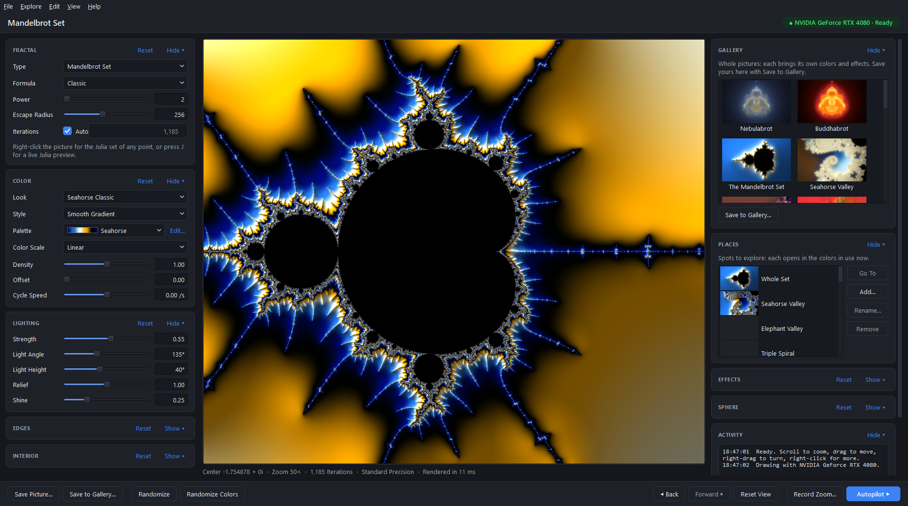
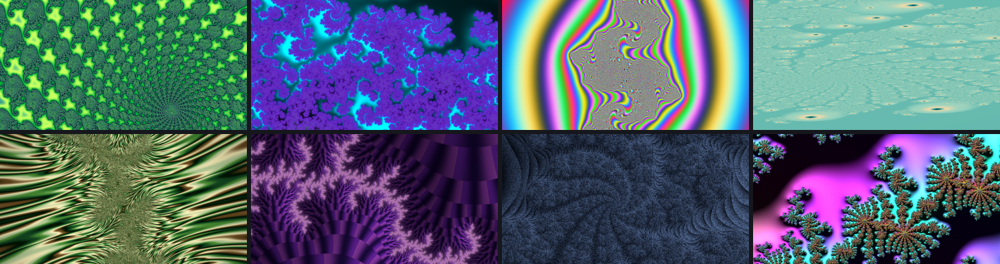
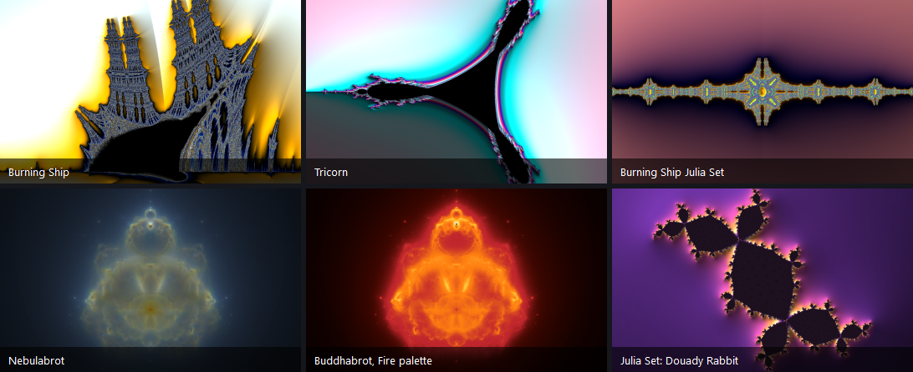
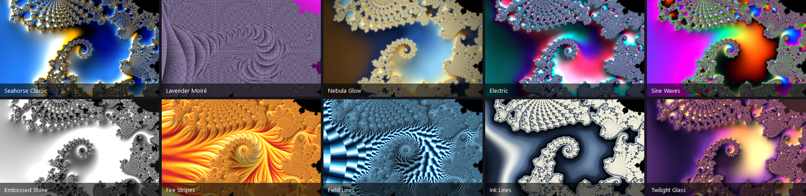
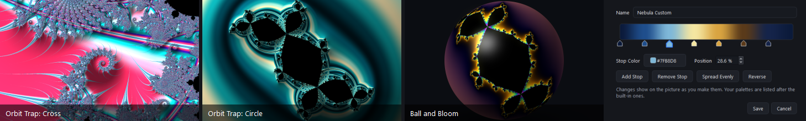
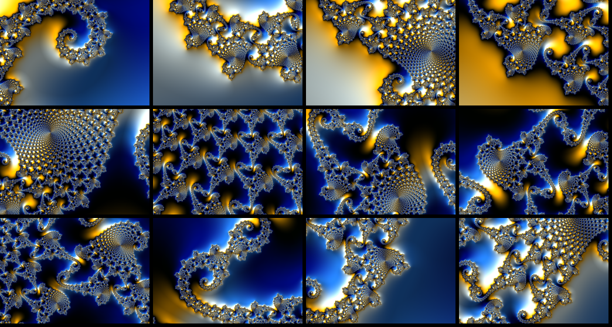
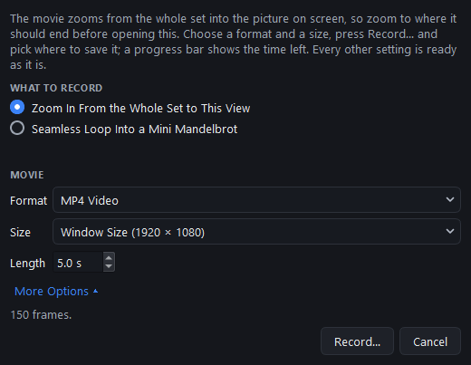
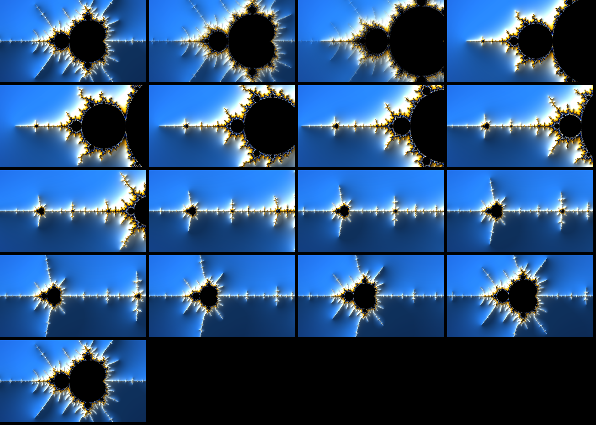

# Mandelbrot Set

Explore the Mandelbrot and Julia sets on your graphics card, zooming as deep as you like: past 10⁻³⁰⁰,
10⁻¹⁰⁰⁰ and beyond, in real time. Color them dozens of ways, let the autopilot dive forever, and record zoom
movies, including seamless loops that repeat endlessly.



## Download

Get `mandelbrotSet.exe` (Windows) from the [Releases](https://github.com/cincottash/mandelbrotSet/releases) page.
It is one file: nothing to install. It needs a graphics card with OpenGL 4.3 (any card from about 2012 on).
A Linux AppImage is built too and is **experimental**: it hasn't been run on a real Linux desktop yet, and MP4
movies are Windows only there (WebP, GIF and PNG frames work).

## First run

The app asks where to keep its settings (theme, colors, saved places, the last view). The suggested folder is
fine. Then scroll to zoom.

## Exploring

| | |
|---|---|
| **Scroll** | zoom in or out at the pointer, smoothly |
| **Drag** | move |
| **Right-drag** | turn |
| **Double-click** | zoom in 4× |
| **Right-click** | zoom or center here, the Julia set of this point, copy the point |
| **J** | a live preview of the Julia set under the pointer |
| **P** | autopilot |
| **Space** | pause or resume the autopilot and color cycling |
| **Ctrl+R** | Randomize: a random fractal, spot and colors |
| **Ctrl+Shift+R** | Randomize Colors: new colors and effects for the same spot |
| **Ctrl+G** | Save to Gallery |
| **Ctrl+Z, Ctrl+Y** | undo and redo changes to the colors and the formula |

**Randomize** (bottom left) picks a random fractal (Mandelbrot, Julia, a higher power, the Burning Ship or the
Tricorn), dives to a random spot with visible detail and colors it at random. **Randomize Colors** keeps the spot
and changes only the colors and effects: the style, palette, lighting, edges and inside, and sometimes bloom, a
vignette, film grain or a sphere. Keep pressing either for new ones; Undo and Back return to earlier ones.



## Fractals

**Type** chooses the Mandelbrot set, a Julia set (right-click any point for its Julia set) or the **Buddhabrot**:
the Mandelbrot set drawn by where its escaping orbits travel, counted on the graphics card and filling in over a
few seconds, as the three-color **Nebulabrot** or through a palette. **Formula** chooses the classic z² + c, the
**Burning Ship** or the **Tricorn**; Power raises the exponent. The classic formula at power 2 zooms without limit;
the others go to about 10⁻²⁴.



The status line shows the center, the zoom, the iteration limit and how long the picture took. Back and Forward
step through the views you visited.

## Gallery and Places

The **Gallery** (also Explore > Gallery) holds whole pictures: a spot together with its own colors and effects.
It comes with 18 famous fractals: the Nebulabrot and the Buddhabrot, Seahorse and Elephant Valley, the Burning
Ship, the Tricorn, the Douady Rabbit and other Julia sets, Pickover stalks, a Julia sphere and more. **Save to
Gallery…** (Ctrl+G) keeps the picture on screen there, first in the list; right-click it to rename or remove it.

**Places** holds just spots to explore: opening one keeps the colors you're using. Add… saves the spot on screen.

## Colors

Ten ready-made **Looks**, and every setting behind them as a slider: the style (smooth gradient, sine waves,
distance bands, stripes, angle, **orbit traps**, and the original Python renders' **moiré fabric**), 20 palettes
plus your own, density, offset, color cycling, lighting (angle, height, relief, shine), glowing edges, the inside's
color or gradient, and effects (hue, saturation, brightness, contrast, gamma, vignette, film grain, **bloom**). The
**Sphere** card wraps the picture onto a lit ball. Right-click any slider to put it back, click **Reset** on a card
to put back all of that card's settings, or use **Edit > Reset Colors to Defaults**. Every change can be undone.
Colors change instantly: only the fractal's shape takes rendering.



**Edit…** beside the palette (or Edit > Edit Palette…) opens the palette editor: drag the color stops along the
gradient, double-click to add one, Delete to remove it. The picture follows every change. Your palettes are kept
with your settings, and a saved location carries its palette along.



## Autopilot

**Autopilot ▶** zooms in on its own, forever, steering toward the richest detail near the middle and backing out
of empty views. Drag to steer it. **❚❚ Pause** (or Space) holds it where it is; **■ Stop** or Escape ends it.
In the Buddhabrot, which takes seconds per picture, it flies through the Mandelbrot set from the same spot.



## Zoom movies and seamless loops



**Record Zoom…** renders a dive from the whole set into the current view:

1. Zoom to where the movie should end.
2. Click **Record Zoom…**, choose a **Format** (MP4 plays everywhere; GIF and WebP loop by themselves in chats and
   browsers) and a **Size**, and a **Length**.
3. Click **Record…** and choose where to save it. A progress bar shows the time left.

Frame rate, anti-aliasing and Full Quality wait under **More Options**, ready as they are. Sizes go up to 4K (8K
and more as PNG frames). **Seamless Loop** finds a mini Mandelbrot inside the
view and zooms along the exact path into it. The mini copy looks like the whole set, the colors are matched at
both ends and the wrap is blended, so the movie repeats forever. Movies are made from keyframes (two per halving
of the view, each a little larger and finer than a frame), so they render several times faster than frame by frame.
**Full Quality** computes every frame on its own instead, for the sharpest finest detail.

<br clear="right">



## Pictures

**Save Picture…** saves any size up to 32768 × 32768 pixels with up to 4 × 4 anti-aliasing. Large pictures are
drawn in pieces, so memory is never the limit.

<details>
<summary><b>Menus</b></summary>

- **File:** Open Location…, Save Location…, Save Picture…, Save to Gallery…, Copy Location, Paste Location, Settings
  (Change App Data Folder…, Reset Settings to Defaults…), Quit
- **Explore:** Back, Forward, Reset View, Zoom In, Zoom Out, Turn Left, Turn Right, Straighten, Add to Places…,
  Randomize Everything, Randomize Colors, Autopilot, Pause Animation, Autopilot Speed, Record Zoom…
- **Edit:** Undo, Redo, Reset Colors to Defaults, Reset Everything to Defaults, Edit Palette…, Delete This Palette
- **View:** Theme, Window Opacity, Julia Preview, Anti-Aliasing, Zoom Speed, Cards on Both Sides, Always on Top,
  Full Screen, Reset View Options
- **Help:** Mouse and Keys, Project Website, Open App Data Folder, Report a Problem, About

</details>

<details>
<summary><b>Command line</b></summary>

```
mandelbrotSet.exe [location.json]                       open a location
mandelbrotSet.exe --render location.json --out picture.png [--size 3840x2160] [--anti-aliasing 2]
mandelbrotSet.exe --record location.json --out zoom.mp4 [--size 1920x1080] [--seconds 20] [--fps 30]
                  [--anti-aliasing 2] [--loop]          a zoom movie (.mp4, .webp, .gif, or a folder for PNG frames)
                  [--full-quality]                      every frame computed on its own (slower)
mandelbrotSet.exe --screenshot window.png               a picture of the window (no dialogs; for checks)
mandelbrotSet.exe --data-folder FOLDER                  keep settings in FOLDER for this run
```

Exit codes: 0 done, 2 bad arguments or file, 3 no OpenGL 4.3, 4 rendering failed, 5 couldn't save.

</details>

<details>
<summary><b>Location files</b></summary>

Plain JSON, readable on any computer (numbers are written as text, never in the system's number format):

```json
{
  "format": "mandelbrotSet location",
  "version": 1,
  "view": { "re": "-0.7436438870371587047521915", "im": "0.1318259042053119704931320",
            "scale": "3e-30", "angle_degrees": 0 },
  "fractal": { "type": "mandelbrot", "power": 2, "auto_iterations": true, "escape_radius": 256 },
  "colors": { "style": 0, "palette": "Seahorse", "density": 1.0 }
}
```

`scale` is half the view's height in the plane. The center keeps every digit the zoom needs. Missing color
settings keep their defaults.

</details>

<details>
<summary><b>How the deep zoom works</b></summary>

- One **reference point** is iterated with arbitrary precision (MPFR) on the processor.
- Every pixel is computed on the graphics card as a small offset from it (**perturbation**), in fast
  single-precision math, with each reference value stored as two floats so nothing is lost where pixels pass
  close to zero. Pixels **rebase** onto the reference's start when they get closer to zero than to the reference,
  which keeps them exact even after the reference escapes.
- A **bilinear approximation** table lets pixels skip thousands of iterations at once while their offset is small.
- Past about 10⁻²⁴ an **extended-range** shader keeps a power-of-two exponent beside each small number, and
  drops back to plain floats whenever a pixel's offset is large enough.
- The raw results (escape time, distance, surface direction, angle, stripes) are colored in a separate pass, so
  color changes never recompute the fractal.
- While the view moves, the last picture follows every movement at once and quick low-resolution previews
  replace it; when the view rests the full picture and then anti-aliasing follow.
- The local tests compare the graphics card's pixels with brute-force arbitrary-precision iteration at zooms
  from 1 to 10⁻¹⁵⁰⁰.

</details>

<details>
<summary><b>Building from source</b></summary>

Windows, with [MSYS2](https://www.msys2.org) (UCRT64):

```
pacman -S mingw-w64-ucrt-x86_64-{gcc,cmake,ninja,qt6-static,qt6-base,qt6-svg,mpfr,gmp,libwebp}
cmake -S . -B build -G Ninja -DCMAKE_BUILD_TYPE=Release
cmake --build build
```

For the single self-contained exe add `-DSTATIC_BUILD=ON -DCMAKE_PREFIX_PATH=/ucrt64/qt6-static`.
Linux: Qt 6.5 or newer, `libmpfr-dev`, `libgmp-dev`, `libwebp-dev`, then the same two cmake lines.

Every merge into the default branch publishes a release with the next version number (see
`.github/workflows/build-apps.yml`).

</details>

<details>
<summary><b>Code layout</b></summary>

- `src/core`: numbers with unlimited range and precision, the view, the reference orbit and its skip table,
  minibrot finding and zoom paths, palettes and color settings, location files (no window code).
- `src/render`: the OpenGL 4.3 engine (`shaders/iterate.comp` computes, `colorize.frag` colors,
  `display.frag` draws) and `RenderCore`, which decides what to render and when.
- `src/app`: the window, the picture widget with its mouse handling and autopilot, the Record Zoom dialog and the
  movie writers.
- `legacy/`: the original Python scripts and one of their 2000 × 2000 renders.

</details>

## License and credits

Copyright (C) 2026 cincottash. Licensed under the [GNU GPL, version 3](LICENSE).

Built with [Qt](https://www.qt.io), [MPFR](https://www.mpfr.org) and [GMP](https://gmplib.org), and
[libwebp](https://chromium.googlesource.com/webm/libwebp). The deep zoom methods (perturbation, rebasing and
bilinear approximation) follow the work shared by Zhuoran, Claude Heiland-Allen and the fractalforums.org
community. The editor themes are adjusted from their original schemes (Nord, Dracula, Solarized, Gruvbox, One
Dark and Light, Tokyo Night, Catppuccin, Rosé Pine, Everforest, Kanagawa, Ayu, Palenight, Night Owl, Cobalt2,
Synthwave '84, Tomorrow, Monokai, Zenburn).
